# 🗄️ Modelo Relacional de Base de Datos y Diccionario de Datos: MediVault

**Motor de Base de Datos:** Relacional SQL (compatible con SQLite 3 / PostgreSQL)  
**Normalización:** Tercera Forma Normal (3FN)  
**Estándar de Seguridad:** Cifrado en reposo AES-256-GCM para campos sensibles  

---

## 1. Diagrama Entidad-Relación (Mermaid ERD)

```mermaid
erDiagram
    ROLES ||--o{ USERS : "posee (1:N)"
    USERS ||--o{ NOTES : "es propietario de (1:N)"
    USERS ||--o{ PASSWORD_RESET_TOKENS : "solicita (1:N)"
    USERS ||--o{ AUDIT_LOGS : "genera actividad en (1:N)"
    USERS ||--o{ GOVERNANCE_CONSENTS : "otorga (1:N)"
    USERS ||--o{ DELETION_REQUESTS : "tramita baja en (1:N)"
    USERS ||--o{ AI_AGENT_LOGS : "ejecuta agente (1:N)"

    ROLES {
        INTEGER id PK "Identificador único"
        TEXT name "Nombre único del rol (admin, colaborador, cliente, auditor)"
        TEXT description "Descripción de permisos"
    }

    USERS {
        INTEGER id PK "Identificador único de usuario"
        TEXT name "Nombre completo"
        TEXT email UK "Correo electrónico único"
        TEXT password_hash "Hash Bcrypt (costo 12) con sal"
        INTEGER role_id FK "Llave foránea a ROLES"
        TEXT sensitive_document_enc "Cédula/Documento cifrado con AES-256-GCM"
        TEXT phone_enc "Teléfono móvil cifrado con AES-256-GCM"
        INTEGER is_active "Estado de la cuenta (1=activo, 0=suprimido)"
        INTEGER failed_login_attempts "Contador de intentos fallidos"
        DATETIME lock_until "Bloqueo temporal anti-fuerza bruta"
        DATETIME created_at "Fecha de registro"
        DATETIME updated_at "Fecha de última modificación"
    }

    NOTES {
        INTEGER id PK "Identificador de la nota clínica"
        INTEGER owner_id FK "Llave foránea al usuario propietario (USERS)"
        TEXT title "Título del expediente o consulta"
        TEXT content_enc "Contenido clínico cifrado (iv.tag.ciphertext)"
        TEXT category "Categoría (diagnostico, receta, laboratorio, etc.)"
        DATETIME created_at "Fecha de creación"
        DATETIME updated_at "Fecha de última edición"
    }

    PASSWORD_RESET_TOKENS {
        INTEGER id PK "Identificador del token"
        INTEGER user_id FK "Llave foránea al usuario (USERS)"
        TEXT token_hash "Hash SHA-256 del token aleatorio de 32 bytes"
        DATETIME expires_at "Fecha y hora de expiración (1 hora)"
        INTEGER used "Bandera de uso (0=vigente, 1=utilizado)"
        DATETIME created_at "Fecha de emisión"
    }

    AUDIT_LOGS {
        INTEGER id PK "Identificador del registro de auditoría"
        TEXT event_type "Tipo de evento (LOGIN_FAILED, ACCESS_DENIED, etc.)"
        INTEGER user_id FK "Usuario involucrado o NULL si es anónimo"
        TEXT ip_address "Dirección IP origen de la petición"
        TEXT user_agent "Navegador y sistema operativo origen"
        TEXT details "Detalles estructurados en formato JSON sanitizado"
        DATETIME created_at "Fecha y hora exacta del evento"
    }

    GOVERNANCE_CONSENTS {
        INTEGER id PK "Identificador del consentimiento"
        INTEGER user_id FK "Llave foránea al usuario (USERS)"
        TEXT consent_type "Tipo (TERMS_AND_CONDITIONS, PRIVACY_POLICY_LEY_8968)"
        INTEGER accepted "Estado de aceptación (1=aceptado)"
        TEXT ip_address "IP desde donde se firmó el consentimiento"
        TEXT version "Versión de la política legal aceptada"
        DATETIME accepted_at "Fecha y hora de la firma"
    }

    DELETION_REQUESTS {
        INTEGER id PK "Identificador de la solicitud de baja"
        INTEGER user_id FK "Llave foránea al usuario (USERS)"
        TEXT status "Estado (PENDING, PROCESSED, REJECTED)"
        TEXT reason "Motivo expresado por el titular"
        TEXT legal_hold_reason "Explicación legal de custodia de diagnósticos"
        DATETIME requested_at "Fecha de radicación"
        DATETIME processed_at "Fecha de ejecución y anonimización"
    }

    AI_AGENT_LOGS {
        INTEGER id PK "Identificador de ejecución"
        TEXT agent_name "Nombre del agente ejecutado"
        INTEGER user_id FK "Usuario que ejecutó el agente"
        TEXT input_summary "Resumen desasociado de la entrada"
        TEXT output_summary "Resumen del resultado"
        INTEGER latency_ms "Tiempo de respuesta en milisegundos"
        DATETIME created_at "Fecha de ejecución"
    }

    EXTERNAL_API_CACHE {
        INTEGER id PK "Identificador"
        TEXT service_name UK "Nombre del servicio (BCCR, HACIENDA, WEATHER)"
        TEXT payload_json "Caché de respuesta en JSON"
        DATETIME updated_at "Fecha de última sincronización"
    }
```

---

## 2. Diccionario de Datos

### Tabla: `roles`
Propósito: Almacena los perfiles de acceso del sistema para la verificación estricta de autorización por roles (RBAC) en servidor.

| Campo | Tipo de Dato | Nulidad | Llave | Descripción |
| :--- | :--- | :--- | :--- | :--- |
| `id` | `INTEGER` | NOT NULL | PK (Auto) | Identificador secuencial del rol. |
| `name` | `TEXT` | NOT NULL | UNIQUE | Nombre del rol (`admin`, `colaborador`, `cliente`, `auditor`). |
| `description` | `TEXT` | NULL | - | Descripción detallada de los privilegios del rol. |

---

### Tabla: `users`
Propósito: Almacena las cuentas de usuario con sus credenciales hasheadas y datos personales sensibles (PII) cifrados.

| Campo | Tipo de Dato | Nulidad | Llave | Descripción |
| :--- | :--- | :--- | :--- | :--- |
| `id` | `INTEGER` | NOT NULL | PK (Auto) | Identificador único de usuario. |
| `name` | `TEXT` | NOT NULL | - | Nombre completo del usuario. |
| `email` | `TEXT` | NOT NULL | UNIQUE | Correo electrónico en minúsculas. |
| `password_hash` | `TEXT` | NOT NULL | - | Hash Bcrypt (costo 12) con sal única. Inicia con `$2a$12$`. |
| `role_id` | `INTEGER` | NOT NULL | FK (`roles.id`) | Rol asignado al usuario. |
| `sensitive_document_enc` | `TEXT` | NULL | - | Cédula costarricense cifrada con AES-256-GCM (`iv.tag.data`). |
| `phone_enc` | `TEXT` | NULL | - | Número de teléfono cifrado con AES-256-GCM (`iv.tag.data`). |
| `is_active` | `INTEGER` | NOT NULL | Default 1 | Estado de la cuenta (1 = Activo, 0 = Inactivo/Suprimido). |
| `failed_login_attempts` | `INTEGER` | NOT NULL | Default 0 | Contador de fallos consecutivos de autenticación. |
| `lock_until` | `DATETIME` | NULL | - | Marca de tiempo hasta la cual la cuenta permanece bloqueada. |
| `created_at` | `DATETIME` | NOT NULL | Default NOW | Fecha y hora de creación de la cuenta. |
| `updated_at` | `DATETIME` | NOT NULL | Default NOW | Fecha y hora de última modificación. |

---

### Tabla: `notes`
Propósito: Bóveda de expedientes clínicos y notas privadas confidenciales. El texto está cifrado de forma autenticada.

| Campo | Tipo de Dato | Nulidad | Llave | Descripción |
| :--- | :--- | :--- | :--- | :--- |
| `id` | `INTEGER` | NOT NULL | PK (Auto) | Identificador de la nota clínica. |
| `owner_id` | `INTEGER` | NOT NULL | FK (`users.id`) | Propietario de la nota. Impide ataques IDOR. |
| `title` | `TEXT` | NOT NULL | - | Título descriptivo del expediente o consulta. |
| `content_enc` | `TEXT` | NOT NULL | - | Contenido clínico confidencial cifrado con AES-256-GCM. |
| `category` | `TEXT` | NOT NULL | Default 'general' | Categoría médica (`diagnostico`, `receta`, `laboratorio`, etc.). |
| `created_at` | `DATETIME` | NOT NULL | Default NOW | Fecha de creación del registro. |
| `updated_at` | `DATETIME` | NOT NULL | Default NOW | Fecha de última edición. |

---

### Tabla: `password_reset_tokens`
Propósito: Custodia de tokens temporales de recuperación de contraseña de un solo uso.

| Campo | Tipo de Dato | Nulidad | Llave | Descripción |
| :--- | :--- | :--- | :--- | :--- |
| `id` | `INTEGER` | NOT NULL | PK (Auto) | Identificador del registro. |
| `user_id` | `INTEGER` | NOT NULL | FK (`users.id`) | Usuario solicitante. |
| `token_hash` | `TEXT` | NOT NULL | INDEX | Hash SHA-256 del token aleatorio de 32 bytes emitido. |
| `expires_at` | `DATETIME` | NOT NULL | - | Fecha de caducidad del token (máximo 1 hora). |
| `used` | `INTEGER` | NOT NULL | Default 0 | 0 si está pendiente de uso, 1 tras haberse consumido. |
| `created_at` | `DATETIME` | NOT NULL | Default NOW | Fecha de emisión. |

---

### Tabla: `audit_logs`
Propósito: Bitácora estructurada de eventos de seguridad forense y monitoreo (OWASP A09).

| Campo | Tipo de Dato | Nulidad | Llave | Descripción |
| :--- | :--- | :--- | :--- | :--- |
| `id` | `INTEGER` | NOT NULL | PK (Auto) | Identificador del evento de auditoría. |
| `event_type` | `TEXT` | NOT NULL | INDEX | Tipo de evento (`LOGIN_SUCCESS`, `LOGIN_FAILED`, `ACCESS_DENIED`). |
| `user_id` | `INTEGER` | NULL | FK (`users.id`) | Usuario asociado al evento o NULL si la petición fue anónima. |
| `ip_address` | `TEXT` | NULL | - | Dirección IP cliente real (extraída vía `trust proxy`). |
| `user_agent` | `TEXT` | NULL | - | Cabecera User-Agent del navegador cliente. |
| `details` | `TEXT` | NULL | - | Objeto JSON con detalles sanitizados (sin contraseñas). |
| `created_at` | `DATETIME` | NOT NULL | Default NOW | Marca de tiempo precisa del evento. |

---

### Tabla: `governance_consents`
Propósito: Registro formal del consentimiento informado de políticas legales conforme a la Ley N.° 8968.

| Campo | Tipo de Dato | Nulidad | Llave | Descripción |
| :--- | :--- | :--- | :--- | :--- |
| `id` | `INTEGER` | NOT NULL | PK (Auto) | Identificador del consentimiento. |
| `user_id` | `INTEGER` | NOT NULL | FK (`users.id`) | Titular de los datos personales. |
| `consent_type` | `TEXT` | NOT NULL | - | Tipo de consentimiento (`PRIVACY_POLICY_LEY_8968`, `TERMS`). |
| `accepted` | `INTEGER` | NOT NULL | - | 1 si fue aceptado explícitamente. |
| `ip_address` | `TEXT` | NULL | - | Dirección IP desde donde se aceptó. |
| `version` | `TEXT` | NOT NULL | - | Versión de la política legal vigente en el momento de la firma. |
| `accepted_at` | `DATETIME` | NOT NULL | Default NOW | Fecha y hora del consentimiento informado. |

---

### Tabla: `deletion_requests`
Propósito: Registro del ejercicio del derecho de supresión y baja del sistema (Ley N.° 8968).

| Campo | Tipo de Dato | Nulidad | Llave | Descripción |
| :--- | :--- | :--- | :--- | :--- |
| `id` | `INTEGER` | NOT NULL | PK (Auto) | Identificador secuencial de la solicitud. |
| `user_id` | `INTEGER` | NOT NULL | FK (`users.id`) | Usuario solicitante. |
| `status` | `TEXT` | NOT NULL | Default 'PENDING' | Estado (`PENDING`, `PROCESSED`, `REJECTED`). |
| `reason` | `TEXT` | NULL | - | Justificación del usuario. |
| `legal_hold_reason`| `TEXT` | NULL | - | Fundamento legal de retención de diagnósticos clínicos. |
| `requested_at` | `DATETIME` | NOT NULL | Default NOW | Fecha de recepción de la solicitud. |
| `processed_at` | `DATETIME` | NULL | - | Fecha de ejecución y anonimización de la cuenta. |

---

### Tabla: `ai_agent_logs`
Propósito: Trazabilidad y auditoría de la ejecución de los 8 agentes de inteligencia artificial.

| Campo | Tipo de Dato | Nulidad | Llave | Descripción |
| :--- | :--- | :--- | :--- | :--- |
| `id` | `INTEGER` | NOT NULL | PK (Auto) | Identificador secuencial. |
| `agent_name` | `TEXT` | NOT NULL | - | Nombre del agente (`Lector de Facturas`, `RAG Clínico`, etc.). |
| `user_id` | `INTEGER` | NULL | FK (`users.id`) | Usuario ejecutor. |
| `input_summary` | `TEXT` | NULL | - | Resumen sanitizado de la entrada enviada al modelo. |
| `output_summary`| `TEXT` | NULL | - | Resumen del resultado generado. |
| `latency_ms` | `INTEGER` | NULL | - | Latencia de procesamiento en milisegundos. |
| `created_at` | `DATETIME` | NOT NULL | Default NOW | Fecha de ejecución. |

---

## 3. Justificación de Normalización (Tercera Forma Normal - 3FN)

El diseño relacional de MediVault cumple rigurosamente con las tres primeras formas normales:
1. **Primera Forma Normal (1FN):**
   * Todos los atributos contienen valores atómicos indivisibles (no existen listas ni arreglos embebidos en campos de texto, con excepción de objetos JSON sanitizados de auditoría no estructurada).
   * Cada tabla cuenta con una Llave Primaria única (`PRIMARY KEY AUTOINCREMENT`).
2. **Segunda Forma Normal (2FN):**
   * Cumple con 1FN y todas las columnas que no forman parte de la llave primaria dependen funcionalmente de la totalidad de la llave primaria, eliminando dependencias parciales.
3. **Tercera Forma Normal (3FN):**
   * Cumple con 2FN y no existen dependencias transitivas (ningún atributo no clave depende de otro atributo no clave). Por ejemplo, los roles de usuario se normalizaron en su propia tabla `roles` referenciada por `role_id`, evitando duplicar nombres o descripciones de permisos en cada fila de usuario.
